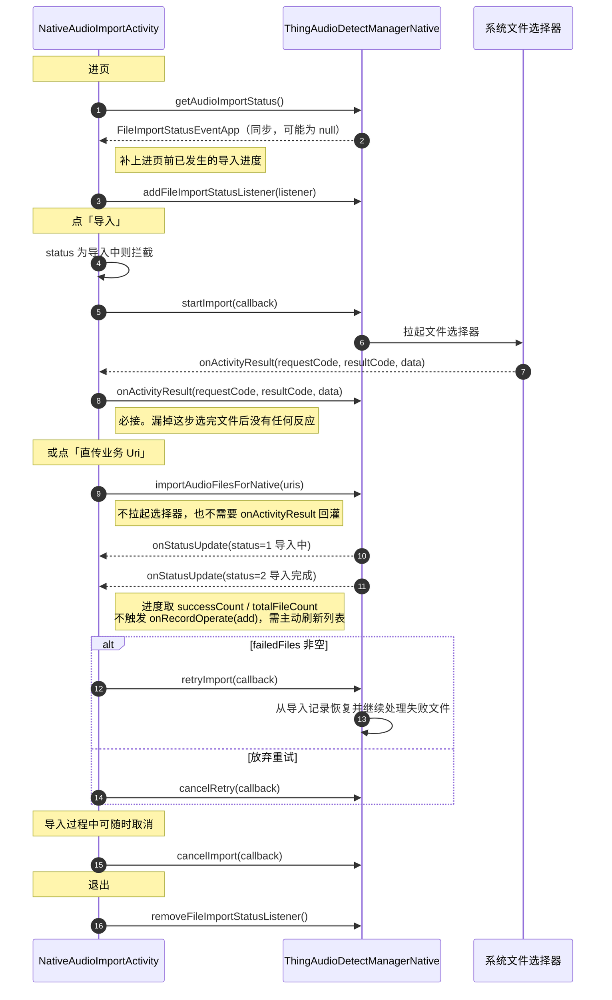

# 模块 5 · 音频导入

| 项 | 内容 |
|---|---|
| Demo 页面 | [`NativeAudioImportActivity`](../../ai_voice/src/main/java/com/tuya/smart/ai_voice/nativeui/impt/NativeAudioImportActivity.kt) |
| 全局约定 | [接入指南](./README.md) |

---

## 一、能力概述

把手机本地已有的音频文件导入为录音记录。导入后它就是一条普通录音，
可以照常转写、总结、翻译、重命名、加标签。

Demo 页使用两个 Tab 分开展示入口：

| Tab | 入口 | 说明 |
|---|---|---|
| 文件选择器 | `startImport` / `retryImport` | 拉起系统文件选择器，宿主必须回灌 `onActivityResult` |
| 业务直传 | `importAudioFilesForNative` | 业务直接传 `Uri`，Demo 使用 `assets/audio_impt` |

两个 Tab 各自展示状态和失败列表，但 SDK 内部是同一个导入任务状态。

导入有两种发起方式：

1. `startImport` 拉起系统文件选择器，由用户选文件；
2. `importAudioFilesForNative` 由业务直接传入 `Uri`，不拉起选择器，
   适合“已经从业务侧拿到音频地址”的场景。

两种方式后续都由 SDK 解码、转码、落库，都使用同一套导入状态监听。
`startImport`、`retryImport` 和 `importAudioFilesForNative` 都不派发录音列表新增事件，
导入完成后调用方需主动刷新列表。直传示例见
[`docs/samples/audio-import-direct-uri.md`](../samples/audio-import-direct-uri.md)。

---

## 二、接口清单

| 方法 | 作用 | 回调 |
|---|---|---|
| `startImport` | 开始导入，会拉起系统文件选择器 | `IAudioImportCallBack` |
| `retryImport` | 从导入记录恢复并重试失败文件 | `IAudioImportCallBack` |
| `importAudioFilesForNative` | 直传业务指定的 Uri 列表；需 SDK >= 7.11.0 | 无 |
| `cancelImport` | 取消进行中的导入 | `IAudioImportCallBack` |
| `cancelRetry` | 放弃重试，清掉失败列表 | `IAudioImportCallBack` |
| `getAudioImportStatus` | 查询导入状态快照 | **同步返回** `FileImportStatusEventApp` |
| `onActivityResult` | 回灌文件选择器 / WiFi 授权结果，**必接** | 同步返回 |

事件监听：`IFileImportStatusListener`。

---

## 三、整体时序



---

## 四、接口详解

### `startImport(IAudioImportCallBack callback)`

开始导入。调用后 SDK 拉起系统文件选择器，用户选完文件的结果**不会自动回到 SDK**，
必须由宿主 Activity 回灌，见 [`onActivityResult`](#onactivityresultint-requestcode-int-resultcode-nullable-intent-data)。

| 参数 | 类型 | 必填 | 说明 |
|---|---|---|---|
| `callback` | `IAudioImportCallBack` | 否 | `onSuccess` 表示导入流程已发起，不代表文件已导入 |

发起前应先判当前状态是否为「导入中」，避免重复发起（重复发起会返回 `20115`）。

---

### `retryImport(IAudioImportCallBack callback)` / `cancelRetry(IAudioImportCallBack callback)`

`status == 2` 且 `failedFiles` 非空时的两条出路：重试或放弃。
`retryImport` 会从已保存的导入记录恢复，**不会拉起文件选择器**，也不需要回灌结果。
重新直传适合 `Uri` 已失效或业务想换文件的场景。

| 参数 | 类型 | 必填 | 说明 |
|---|---|---|---|
| `callback` | `IAudioImportCallBack` | 否 | 结果回调 |

`cancelRetry` 清掉失败列表，之后可重新发起一次全新的导入。

---

### `importAudioFilesForNative(@NonNull List<Uri> uris)`

直传业务指定的音频文件，不拉起系统文件选择器。需要 SDK >= 7.11.0。

| 参数 | 类型 | 必填 | 说明 |
|---|---|---|---|
| `uris` | `List<Uri>` | 是 | 待导入文件；支持 `content://` 与 `file://` |

行为与约定：

- 不返回回调，导入进度以 `IFileImportStatusListener` 为准；
- 同一时刻只允许一个批次；重复调用会取消上一批次尚未完成的导入；
- 重复 `Uri` 不去重，会逐文件独立导入；
- `content://` 必须可读，`file://` 通常是应用私有文件；
- SDK 导入会持有临时副本，但调用后尽快导入更可靠，不要长期复用未持久化授权的 `content://`。

```java
List<Uri> uris = Arrays.asList(
        Uri.fromFile(new File(getCacheDir(), "meeting_01.mp3")),
        Uri.fromFile(new File(getCacheDir(), "meeting_02.m4a")),
        Uri.fromFile(new File(getCacheDir(), "meeting_03.wav"))
);
manager.importAudioFilesForNative(uris);
```

---

### `cancelImport(IAudioImportCallBack callback)`

取消进行中的导入。已成功导入的文件**保留**，只中止尚未处理的部分。

| 参数 | 类型 | 必填 | 说明 |
|---|---|---|---|
| `callback` | `IAudioImportCallBack` | 否 | 结果回调 |

---

### `getAudioImportStatus()`

**同步返回** [`FileImportStatusEventApp`](#fileimportstatuseventapp)，无进行中任务时返回 `null`。

导入是跨页面的后台任务，用户完全可能在导入中途切走再切回。
进页调一次取快照，把界面恢复到当前进度，之后靠监听增量更新——**不要轮询**。

---

### `onActivityResult(int requestCode, int resultCode, @Nullable Intent data)`

把宿主 Activity 的结果回灌给 SDK。**Native 接入必接**。
该入口同时处理音频导入的文件选择器结果，以及模块 4 AP 建链时的系统 WiFi 授权结果。

| 参数 | 类型 | 必填 | 说明 |
|---|---|---|---|
| `requestCode` | `int` | 是 | 原样透传，**无需自行判断**，SDK 内部识别是否属于自己的请求 |
| `resultCode` | `int` | 是 | 原样透传 |
| `data` | `Intent` | 否 | 原样透传，用户取消操作时可能为 `null` |

```java
@Override
protected void onActivityResult(int requestCode, int resultCode, @Nullable Intent data) {
    super.onActivityResult(requestCode, resultCode, data);
    ThingAudioDetectManagerNative.getInstance()
            .onActivityResult(requestCode, resultCode, data);
}
```

> 漏掉这一步时，导入表现为「选完文件后毫无反应」，AP 建链会停在 `apConnectState == 0`，
> 都不会有报错或状态事件。
> 这是本模块最容易踩的坑。

---

### 事件监听 · `IFileImportStatusListener`

```java
manager.addFileImportStatusListener(listener);
manager.removeFileImportStatusListener();   // 注意：无参
```

| 回调 | 说明 |
|---|---|
| `onStatusUpdate(FileImportStatusEventApp event)` | 导入状态与进度推送 |

> `removeFileImportStatusListener()` **无参**，会移除**全部**已注册的导入监听。
> 多个页面同时注册时，任一页面退出都会把其他页面的监听一并摘掉。

---

## 五、数据结构

### `FileImportStatusEventApp`

`getAudioImportStatus` 的返回值，也是 `onStatusUpdate` 的回调参数。

| 字段 | 类型 | 说明 |
|---|---|---|
| `status` | `Int` | 导入状态，取值见下表 |
| `errorCode` | `Int?` | 任务级错误码，`status` 为 `3` / `4` 时有效 |
| `errorMessage` | `String?` | 错误消息 |
| `totalFileCount` | `Int?` | 本次导入的文件总数 |
| `successCount` | `Int?` | 已成功导入数，进度即 `successCount / totalFileCount` |
| `failedFiles` | `List<FailedFileInfo>?` | 失败文件列表 |
| `importedFiles` | `List<FileImportedFileInfo>?` | 成功明细，含 `recordId` / `fileId` / `sourceUri` / `displayName` / `durationMs` |
| `timestamp` | `Long` | 事件时间戳 |

**`status` 取值**

| 值 | 含义 | 界面处理 |
|---|---|---|
| `0` | 未开始 | 可发起导入 |
| `1` | 导入中 | 展示进度，拦截重复发起，提供「取消导入」 |
| `2` | 导入完成 | **还要看 `failedFiles`**，非空时提供「重试 / 放弃」 |
| `3` | 导入中断 | 看 `errorCode` |
| `4` | 分享导入异常 | 由系统分享入口触发的导入失败，看 `errorCode` |

> `status == 2` 不等于全部成功。部分文件失败时状态同样是 `2`，
> 只有 `failedFiles` 为空才是真正的全部成功。

### `FailedFileInfo`

| 字段 | 类型 | 说明 |
|---|---|---|
| `fileName` | `String?` | 失败的文件名，用于展示给用户 |
| `errorCode` | `Int?` | 该文件的失败原因，取值见[第七节](#七错误码) |

---

### `FileImportedFileInfo`

单条音频导入成功后的明细。`importedFiles` 只在成功时返回对应条目。

| 字段 | 类型 | 说明 |
|---|---|---|
| `sourceUri` | `Uri` | 调用 `importAudioFilesForNative` 时传入的原始 Uri |
| `recordId` | `String` | 业务录音 ID，用于打开详情页 |
| `fileId` | `Long` | 录音文件数据库主键，发起转写 / 总结任务时使用 |
| `durationMs` | `Long` | 音频时长，单位毫秒 |
| `displayName` | `String?` | 显示名，含扩展名 |

---

## 六、关键约定

### 支持范围与上限

| 项 | 当前支持 |
|---|---|
| 音频格式 | MP3 / M4A / WAV |
| URI 协议 | `content://` / `file://` |
| 单文件大小 | 不超过 500 MB |
| 单文件时长 | 不超过 5 小时 |
| 单批数量 | 20 个 |

超过限制时不会生成录音记录，会出现在 `failedFiles` 中。

### 按原因归类展示失败

失败码有 11 个，但可归纳的原因只有 6 类。逐条罗列裸码对用户没有意义，
建议按原因分组、每组下挂文件名：

```
3 个文件导入失败

格式不支持或文件损坏
  · 会议录音.amr
  · 备忘.wma

文件时长过长
  · 长播客.mp3
```

### 导入成功的文件会进录音列表

导入完成后这些文件就是普通录音记录。`startImport`、`retryImport` 和
`importAudioFilesForNative` 都**不触发** `IRecordFileUpdateCallback.onRecordOperate`，
导入完成（`status == 2`）后由调用方自行刷新录音列表。

---

## 七、错误码

分两个层级，来自事件对象的不同字段。

### 任务级 —— `FileImportStatusEventApp.errorCode`

整个导入任务失败的原因，`status` 为 `3` / `4` 时有效。

| 码 | 含义 |
|---|---|
| `20101` | 文件数量超出上限 |
| `20102` | 单个文件过大 |
| `20104` | 手机存储空间不足 |
| `20115` | 导入已经开始，无法重复导入 |
| `20116` | 录音进行中，无法导入 |
| `20117` | 存在可恢复的导入任务，无法重复导入 |
| `20118` | 存在导入失败的记录（兜底码） |

### 文件级 —— `FailedFileInfo.errorCode`

`failedFiles` 里每个失败文件各自的原因。

| 码 | 含义 | 建议归类 |
|---|---|---|
| `20103` | 格式异常 | 格式不支持或文件损坏 |
| `20110` | 文件格式错误，无法解码 | 同上 |
| `20105` | 文件不存在 | 文件不存在 |
| `20106` | 文件属性已改变 | 文件已被修改或移动 |
| `20107` | 文件时长过长 | 文件时长过长 |
| `20111` | 因文件错误导致解码中断 | 导入中断 |
| `20112` | 导入异常中断 | 同上 |
| `20108` | SDK 初始化失败 | 系统繁忙 |
| `20109` | 启动音频解码失败 | 同上 |
| `20113` | mp3 创建失败 | 同上 |

---

## 八、接入清单

1. **宿主 Activity 必须重写 `onActivityResult` 并调用 SDK 的 `onActivityResult`**，
   `requestCode` 无需自行判断。漏掉这步导入或 AP 建链都会静默失败
2. 进页调一次 `getAudioImportStatus()` 取快照（同步返回，**可能为 `null`**），
   之后靠 `IFileImportStatusListener` 增量更新，不要轮询
3. 发起前判「是否正在导入」，避免重复发起触发 `20115`
4. `status == 2` 时还要检查 `failedFiles`，非空才说明有文件失败
5. 失败原因按类归并展示，不要把裸码抛给用户
6. `removeFileImportStatusListener()` **无参**，会移除全部导入监听，多页面注册时注意
7. `cancelImport` 只中止未处理的部分，已导入的文件保留
8. 业务直传用 `importAudioFilesForNative`，`SDK >= 7.11.0`；
   发起前检查格式、大小、时长、数量和 Uri 读权限
9. `startImport` / `retryImport` / `importAudioFilesForNative` 均不触发
   `onRecordOperate`；完成后主动重拉录音列表
10. `onStatusUpdate` 可能在子线程；更新 UI、弹窗或跳转前必须切主线程
