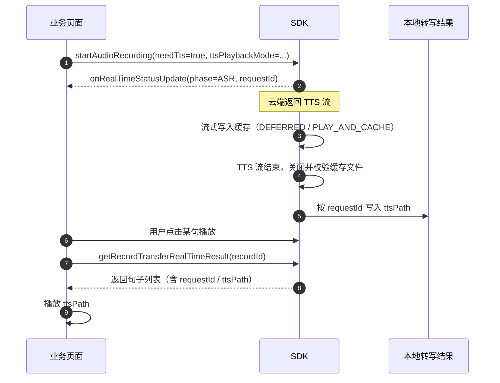

# 面对面翻译 TTS · 设置、缓存与回放

面向接入 `recordMode=3`（面对面翻译，入门版耳机）的 Android 工程。本文只覆盖 TTS 链路：

1. 如何设置 `TtsPlaybackMode`；
2. 如何从实时转写结果中获取单句 `ttsPath`；
3. 如何播放缓存下来的 TTS。

同时说明 `f2fChannel` 在双通道中的职责，避免把「输入分流」和「TTS 输出」混为一谈。

完整 Demo 见
[`NativeFaceToFaceActivity.kt`](../../ai_voice/src/main/java/com/tuya/smart/ai_voice/nativeui/NativeFaceToFaceActivity.kt)。

---

## 一、先分清四个概念

| 字段 / 配置 | 决定什么 | 不决定什么 |
|---|---|---|
| `f2fChannel` | 这一帧音频进入左还是右 VAD / ASR 流水线 | 不决定 TTS 从手机还是耳机输出 |
| `audioSource` | 从手机麦克风还是入门版耳机采集 | 不决定译文从哪里播放 |
| `ttsConfig` | TTS 输出到手机本机还是蓝牙耳机 | 不决定是否实时播放、是否缓存 |
| `ttsPlaybackMode` | 实时播放、只缓存、边播边缓存 | 不决定输出设备 |

另外两个 ID 不要混用：

| ID | 作用 |
|---|---|
| `recordId` | 一次录音会话的完整 ID，用于查询整场实时转写结果 |
| `requestId` | 一句话的请求 ID，用于把某句 ASR / 译文和它的 `ttsPath` 对上 |

`recordId` 直接取 `onRecordStatusUpdate` 的 `bean.recordId`。SDK 返回的已经是完整会话 ID，
**不要自行拼接 `_0` 或其他后缀**。

---

## 二、设置 `TtsPlaybackMode`

### 2.1 三种模式

`TtsPlaybackMode` 只在 `needTts=true` 时生效；不传时按 `IMMEDIATE` 处理。

| 模式 | 实时播放 | 缓存 TTS | 能拿到 `ttsPath` |
|---|---:|---:|---:|
| `IMMEDIATE` | 是 | 否 | 否 |
| `DEFERRED` | 否 | 是 | 是 |
| `PLAY_AND_CACHE` | 是 | 是 | 是 |

选择建议：

- 只需要边听边看译文：`IMMEDIATE`；
- 先不打扰用户，之后点某句话再播放：`DEFERRED`；
- 既要实时播放，又允许之后回听：`PLAY_AND_CACHE`。

左、右通道可以各保存一份播放模式，切到哪条通道就把对应值写进当前 `params`。
下文的 `friendPlayback` / `myPlayback` 就是这种用法。

### 2.2 面对面翻译的基础参数

下面按 Demo 的实际参数构造，省略了设备来源和语言选择的业务逻辑：

```kotlin
private const val CHANNEL_FRIEND = 0
private const val CHANNEL_MY = 1

private const val RECORD_MODE_F2F = 3
private const val AUDIO_PHONE_MIC = 1          // SYSTEM_PHONE_MIC_16K_MONO
private const val AUDIO_ENTRY_EARPHONE = 0     // SYSTEM_BLUETOOTH_16K_MONO
private const val OUTPUT_PHONE = 0
private const val OUTPUT_BT = 1

// 需要耳机采集时，把 friendInput / myInput 改成 AUDIO_ENTRY_EARPHONE
private var friendInput = AUDIO_PHONE_MIC
private var myInput = AUDIO_PHONE_MIC
private var friendOutput = OUTPUT_PHONE
private var myOutput = OUTPUT_PHONE
private var friendPlayback = TtsPlaybackMode.DEFERRED
private var myPlayback = TtsPlaybackMode.PLAY_AND_CACHE
private var friendLang = "zh"
private var myLang = "en"

private fun buildParams(channel: Int): RecordParamsV2 {
    val input = if (channel == CHANNEL_FRIEND) friendInput else myInput
    val playback = if (channel == CHANNEL_FRIEND) friendPlayback else myPlayback

    val params = RecordParamsV2()
    params.businessType = 0
    params.recordMode = RECORD_MODE_F2F
    params.f2fChannel = channel

    params.audioSource = input
    params.audioSourceList = listOf(input)

    params.needAsr = true
    params.needTranslate = true
    params.needTts = true
    params.ttsPlaybackMode = playback
    params.ttsConfig = buildTtsConfig(
        useBluetooth = (if (channel == CHANNEL_FRIEND) friendOutput else myOutput) == OUTPUT_BT
    )

    params.originalLanguage =
        if (channel == CHANNEL_FRIEND) friendLang else myLang
    params.targetLanguage =
        if (channel == CHANNEL_FRIEND) myLang else friendLang
    return params
}
```

### 2.3 `f2fChannel` 与语言方向

`recordMode=3` 使用 `FaceToFacePhoneMicRecordExecutor`。它内部有左右两条独立的
VAD / ASR 流水线，`f2fChannel` 决定当前采集到的音频进哪一条：

| `f2fChannel` | 业务含义 | `originalLanguage` | `targetLanguage` |
|---:|---|---|---|
| `0` | 朋友 / 左侧通道 | 朋友的语言 | 我的语言 |
| `1` | 我 / 右侧通道 | 我的语言 | 朋友的语言 |

Demo 用两个方向按钮分别启动两条通道。两个方向共用同一个 `recordId`，
但每一句话的 `requestId` 独立；界面展示时应使用 `onRealTimeStatusUpdate.channel`
判断句子属于哪一侧，不要根据当前按钮状态给历史句子换边。

**切方向必须发生在句间。** 一句话说到一半切换 `f2fChannel`，这句话会被拆到两条
ASR 流水线里，表现为半句丢失或重复。

### 2.4 首次启动与中途切换

首次启动和中途改参数都走 `startAudioRecording`，通过 `params.updateParams` 区分：

```kotlin
private fun applyChannel(channel: Int, updating: Boolean) {
    val params = buildParams(channel)
    params.updateParams = updating
    manager.startAudioRecording(recordingDeviceId(), params, object : IResultCallback {
        override fun onSuccess() {
            // 参数已提交；真正的录音状态以 onRecordStatusUpdate 为准
        }

        override fun onError(code: String?, error: String?) {
            // 处理错误
        }
    })
}
```

| 当前状态 | `updateParams` |
|---|---:|
| 空闲 / 已停止，首次开录 | `false` |
| 录音中切方向、换输入 / 输出、换播放模式 | `true` |
| 暂停中，同方向恢复 | `false` |
| 暂停中，切方向或改配置 | `true` |

`updateParams=true` 表示在现有录音任务上原地更新参数，不要先 `stopRecordTransfer` 再重启。
只改语言对时也可以使用 `manager.updateParams(...)`，Demo 为统一路径使用了
`startAudioRecording` + `updateParams=true`。

### 2.5 TTS 输出配置

手机本机和普通蓝牙耳机都只下发**一条** `ttsConfig`：

```kotlin
private fun buildTtsConfig(useBluetooth: Boolean): TTSConfig = TTSConfig(
    devId = "",
    output = if (useBluetooth) TTSOutput.SYSTEM_BLUETOOTH else TTSOutput.SYSTEM_MIC,
    encode = TTSEncode.DEFAULT,
    channel = TTSOutputChannel.DEFAULT
)
```

输出源为手机或系统蓝牙时，`devId` 传空字符串。
输出源也可以按通道保存，Demo 中的 `friendOutput` / `myOutput` 会在切通道时随参数下发。

> **不要用两条 `ttsConfig` 表示「左通道和右通道」。**
> 两条配置会创建第二个 TTS player，当前手机 / 普通蓝牙输出场景下可能覆盖引擎拉流回调，
> 表现为「有 ASR、有译文，但没有声音」。只有 Pro 耳机双通道输出等场景才使用
> `ttsConfigList`。

---

## 三、`ttsPath` 什么时候产生

`ttsPath` 不是句子刚封句就立刻可用的。缓存型模式下的链路大致如下：



内部缓存链路（排查时使用）：

`onTTSStart` → 流式写入缓存 → `onTTSStop` → `TtsCacheWriter.finish()` →
`updateTtsPath(requestId, path)` → 后续查询才能读到 `ttsPath`。

因此：

- `IMMEDIATE` 不写缓存，查询结果里的 `ttsPath` 为空是正常的；
- `DEFERRED` / `PLAY_AND_CACHE` 也要等 TTS 流结束后才有路径；
- 点击播放时查不到路径，不等于录音失败，可能只是这句话的 TTS 还没合成完。

`ttsPath` 指向应用私有目录中的缓存文件，不建议复制到公共目录或当作永久文件保存。
录音被删除时，对应的 TTS 缓存目录也可能被清理。

---

## 四、获取某句话的 `ttsPath`

### 4.1 保存会话 ID 和句子 ID

不要在播放时重新猜 `requestId`。在实时转写事件到达时，把它绑定到当前句子：

```kotlin
private var recordId: String? = null

private class SentenceUi(var requestId: String? = null)
private var currentSentence: SentenceUi? = null

override fun onRecordStatusUpdate(deviceId: String, bean: RecordStatusBean?) {
    if (bean == null) return
    if (!bean.recordId.isNullOrEmpty()) {
        // SDK 已返回完整会话 ID；不要拼 _0
        recordId = bean.recordId
    }
}

override fun onRealTimeStatusUpdate(status: RealTimeTransferStatus) {
    // 只在 ASR 阶段取 requestId；把它保存到当前句子的 UI 模型
    if (status.phase == PHASE_ASR && !status.requestId.isNullOrEmpty()) {
        currentSentence?.let { it.requestId = status.requestId }
    }
}
```

`PHASE_ASR` 是实时转写事件中的 ASR 阶段常量，按工程内已有定义使用即可。

### 4.2 查询并匹配

```kotlin
private fun playCachedTts(requestId: String) {
    val rid = recordId
    if (rid.isNullOrEmpty()) return

    manager.getRecordTransferRealTimeResult(
        null, rid, null,
        object : IRecordCallBack<MutableList<RecordTransferRealTimeResult?>?> {
            override fun onSuccess(result: MutableList<RecordTransferRealTimeResult?>?) {
                val path = result
                    ?.firstOrNull { item ->
                        item?.requestId == requestId && !item.ttsPath.isNullOrEmpty()
                    }
                    ?.ttsPath

                if (path.isNullOrEmpty()) {
                    // 可能还没合成完，或当前播放模式不缓存
                    runOnUiThread { showTtsNotReady() }
                    return
                }
                runOnUiThread { playTts(path) }
            }

            override fun onError(code: String?, error: String?) {
                runOnUiThread { showTtsNotReady() }
            }
        }
    )
}
```

必须按 `requestId` 匹配，不要按列表下标或 `text` 匹配。实时转写结果包含两条通道的句子；
业务界面还可能裁剪或重排历史句子，不能把列表位置当作句子身份。

---

## 五、播放缓存 TTS

Demo 在每句话的气泡旁常驻播放入口，点击时才查询 `ttsPath`。这样不会因为 TTS 尚未合成完
而提前隐藏按钮，也不会为每条句子预先发一次查询。

播放器建议使用异步准备，避免在主线程同步 `prepare()`：

```kotlin
private var ttsPlayer: MediaPlayer? = null

private fun playTts(path: String) {
    stopTts()
    val player = MediaPlayer()
    ttsPlayer = player
    try {
        player.setDataSource(path)
        player.setOnPreparedListener { it.start() }
        player.setOnCompletionListener { releaseTtsPlayer(it) }
        player.setOnErrorListener { p, _, _ ->
            releaseTtsPlayer(p)
            true
        }
        player.prepareAsync()
    } catch (e: Exception) {
        releaseTtsPlayer(player)
        showTtsPlayFailed()
    }
}

private fun releaseTtsPlayer(player: MediaPlayer) {
    if (ttsPlayer === player) {
        ttsPlayer = null
    }
    runCatching { player.release() }
}

private fun stopTts() {
    ttsPlayer?.let { player ->
        runCatching { player.stop() }
        releaseTtsPlayer(player)
    }
}

override fun onDestroy() {
    stopTts()
    super.onDestroy()
}
```

几个边界：

- 同一时刻只保留一个播放器，播新句子前先停旧的；
- `MediaPlayer` 的创建、`prepareAsync()` 和释放放在主线程；
- 播放失败要复位按钮状态，不要留下「一直显示播放中」；
- 音频焦点、耳机路由和来电打断由业务播放器负责。示例只负责把本地文件播出来，
  不对音频焦点做全局接管。

---

## 六、Java 调用对照

| 动作 | Kotlin | Java |
|---|---|---|
| 设置播放模式 | `params.ttsPlaybackMode = TtsPlaybackMode.DEFERRED` | `params.setTtsPlaybackMode(TtsPlaybackMode.DEFERRED);` |
| 设置 TTS 输出 | `TTSConfig("", TTSOutput.SYSTEM_MIC, TTSEncode.DEFAULT, TTSOutputChannel.DEFAULT)` | `new TTSConfig("", TTSOutput.SYSTEM_MIC, TTSEncode.DEFAULT, TTSOutputChannel.DEFAULT);` |
| 查询实时结果 | `manager.getRecordTransferRealTimeResult(null, recordId, null, callback)` | 同签名 |
| 读取单句字段 | `item.requestId` / `item.ttsPath` | `item.requestId` / `item.ttsPath`（公开字段） |
| 设置更新标记 | `params.updateParams = true` | `params.setUpdateParams(true);` |
| 创建播放器 | `MediaPlayer()` | `new MediaPlayer();` |

Java 中回调也要注意线程：`onSuccess` / `onError` 可能不在主线程，
更新 UI 前切回主线程。

---

## 七、排查清单

| 现象 | 优先检查 |
|---|---|
| 点击播放一直提示 TTS 未就绪 | 当前是否为 `DEFERRED` / `PLAY_AND_CACHE`；TTS 是否已经结束；`requestId` 是否绑定到了正确句子 |
| 有 ASR、有译文，但没有 TTS 声音 | `needTts` 是否为 `true`；`ttsConfig.output` 是否指向正确的手机 / 耳机通道 |
| `DEFERRED` 没有实时声音 | 正常。`DEFERRED` 只缓存，不自动播放，需要业务按 `ttsPath` 回放 |
| 两条通道都配置后反而没有声音 | 是否误用了两条 `ttsConfig`；当前手机 / 普通蓝牙场景只保留一条 |
| 查询结果为空或找不到句子 | `recordId` 是否来自 `onRecordStatusUpdate` 的完整值；是否拿当前通道的 `requestId` 去匹配历史句 |
| 切换方向后句子错位或半句丢失 | 是否在一句话中间切换 `f2fChannel`；语言对是否和方向同步切换 |

---

## 八、接入检查清单

- `recordMode=3`，`f2fChannel` 为 `0` 或 `1`；
- `needAsr=true`、`needTranslate=true`、`needTts=true`；
- `ttsPlaybackMode` 与业务需要的「实时播放 / 仅缓存」一致；
- `ttsConfig` 只下发一条，输出源和实际设备匹配；
- 首次启动 `updateParams=false`，中途切方向 / 改配置 `updateParams=true`；
- 从 `onRecordStatusUpdate` 保存完整 `recordId`；
- 从实时转写事件保存每句话的 `requestId`；
- 用户点击时再查 `ttsPath`，为空时允许稍后重试；
- 页面销毁时释放 `MediaPlayer`。
